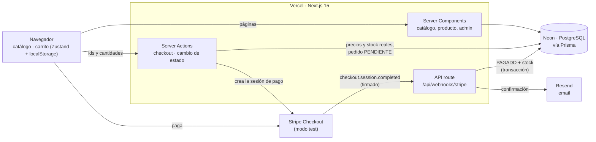

# Tostadero · tienda online de café de especialidad

[](https://github.com/fgarcialopez474-arch/tostadero/actions/workflows/ci.yml)

Tienda online completa, de punta a punta: catálogo con búsqueda y filtros, carrito persistente, pago con Stripe
confirmado por **webhook**, email de confirmación y panel de administración. Desplegada en Vercel con CI.

**Demo en producción:** https://tostadero.vercel.app

> Stripe está en **modo test**: paga con la tarjeta `4242 4242 4242 4242`, cualquier fecha futura y cualquier CVC.
> No se cobra nada.

Proyecto Ecommerce del Master Desarrollo Agéntico (The Power), construido paso a paso en 4 sesiones.
Tienda y marcas ficticias: café en grano, cafeteras, molinillos y accesorios, con marca propia **Tostadero**.

## Qué hace

- **Catálogo** con búsqueda por nombre y filtros por **categoría, marca y precio**, resueltos en el servidor a partir
  de la URL (cualquier búsqueda se puede compartir).
- **Ficha de producto** con ruta dinámica, stock, "agotado" y página 404.
- **Carrito** con Zustand que sobrevive a recargar y a cerrar el navegador (localStorage), sin errores de hidratación.
- **Checkout** con Stripe desde una Server Action: del navegador solo llegan ids y cantidades; precios y stock se releen
  de la base de datos.
- **Webhook firmado**: el único punto que marca un pedido como PAGADO, descuenta stock y envía el email.
- **Email de confirmación** con Resend.
- **Panel de admin** protegido: pedidos por estado, detalle y cambios de estado (pagado → enviado → entregado).

## Arquitectura



El flujo de un pago:

1. El cliente pulsa **Pagar**. La Server Action recibe solo ids y cantidades, relee precios y stock en Neon, crea el
   pedido en **PENDIENTE** y redirige a Stripe Checkout.
2. El cliente paga en la página de Stripe.
3. Stripe llama al **webhook** desde sus servidores. El webhook verifica la firma y, en una transacción, pasa el pedido a
   **PAGADO** y descuenta el stock. Después envía el email.
4. Stripe devuelve al cliente a `/checkout/exito`, que solo **lee** el pedido y vacía el carrito.

## Stack

| Capa | Tecnología |
|---|---|
| Framework | Next.js 15 (App Router, Server Components, Server Actions) + TypeScript |
| UI | Tailwind CSS 4 + shadcn/ui (Base UI) |
| Estado del carrito | Zustand 5 + persist |
| Base de datos | PostgreSQL en Neon + Prisma 7 (driver adapter pg) |
| Pagos | Stripe Checkout + webhooks (modo test) |
| Emails | Resend |
| Calidad | ESLint, TypeScript estricto, Vitest, GitHub Actions |
| Despliegue | Vercel (deploy automático en cada push a `main`) |

## Decisiones de diseño

1. **Precios en céntimos** (enteros) en la base de datos y en Stripe: sin errores de coma flotante. Se formatean solo
   al pintarlos.
2. **El pedido se confirma en el webhook, no en la página de éxito.** Si el cliente cierra el navegador tras pagar, el
   pedido se confirma igual; y abrir `/checkout/exito` a mano no puede marcar nada como pagado.
3. **Nada que venga del navegador es fiable.** El checkout recalcula precios y stock; los filtros de la URL se validan;
   cada Server Action del admin vuelve a comprobar la sesión (el middleware protege páginas, no acciones).
4. **Webhook idempotente y atómico.** Solo cambia pedidos en PENDIENTE, así un evento repetido no descuenta stock dos
   veces; marcar PAGADO y descontar stock van en la misma transacción. Si el email falla, el pedido sigue pagado.
5. **Cambios de estado sin carreras.** El admin solo guarda si el pedido sigue en el estado que se comprobó: dos clics
   a la vez no se saltan las transiciones permitidas.
6. **Carrito sin errores de hidratación.** El servidor no tiene localStorage: el carrito guardado se carga justo después
   de hidratar (`skipHydration`), y la página de éxito espera a esa carga antes de vaciarlo.
7. **Secretos solo en el servidor.** `server-only` en `lib/stripe.ts` y `lib/email.ts`: si un componente de cliente los
   importa, el build falla. Solo la clave publicable de Stripe lleva `NEXT_PUBLIC_`.

## Ejecutarlo en local

Necesitas Node.js 20+, una base PostgreSQL (Neon free tier o `docker compose up -d`), una cuenta de Stripe en modo
test, la [Stripe CLI](https://docs.stripe.com/stripe-cli) y una cuenta de Resend.

```bash
npm install                 # dependencias + cliente de Prisma (postinstall)
cp .env.example .env        # y rellena los valores
npm run db:check            # comprueba que la base responde
npx prisma migrate deploy   # crea las tablas
npm run seed                # 4 categorías, 3 marcas y 12 productos
npm run stripe:check        # comprueba las claves de Stripe (sin cobrar nada)
npm test                    # tests de reglas de negocio (Vitest)
npm run dev                 # http://localhost:3000
# en otra terminal: reenviar los eventos de Stripe al webhook local
# (su secreto whsec_ va en STRIPE_WEBHOOK_SECRET)
stripe listen --events checkout.session.completed --forward-to localhost:3000/api/webhooks/stripe
```

`npx prisma studio` abre un visor de las tablas en http://localhost:5555. El panel de admin está en `/admin`
(contraseña en `ADMIN_PASSWORD`).

## Desplegarlo en Vercel

1. Importa el repositorio en Vercel (Next.js se detecta solo; `postinstall` genera el cliente de Prisma). No hace falta
   añadir las integraciones opcionales: las claves van como variables de entorno.
2. Variables de entorno: `DATABASE_URL`, `DIRECT_URL`, `STRIPE_SECRET_KEY`, `NEXT_PUBLIC_STRIPE_PUBLISHABLE_KEY`,
   `RESEND_API_KEY`, `EMAIL_PRUEBAS` y `ADMIN_PASSWORD`.
3. En Stripe (modo test, Workbench → Webhooks → Add destination): evento `checkout.session.completed` y URL
   `https://TU-DOMINIO/api/webhooks/stripe`. Su signing secret (distinto del de `stripe listen`) va en Vercel como
   `STRIPE_WEBHOOK_SECRET`; después, redeploy.
4. Usa el dominio de producción (`*.vercel.app` sin hash): las URLs de cada despliegue están protegidas por Vercel.

## Estructura

```
docs/ESPECIFICACION.md     páginas, modelo de datos, catálogo y reglas
src/app/                   páginas (App Router): catálogo, producto/[id], carrito, checkout, admin
src/app/checkout/          Server Action del checkout y páginas de éxito y cancelado
src/app/api/webhooks/      webhook de Stripe (la única API route)
src/app/admin/             panel, detalle de pedido, entrada y Server Actions del admin
src/components/            cabecera, tarjetas, filtros, carrito, admin (y ui/ de shadcn)
src/lib/                   prisma, stripe, email, catálogo, estados, admin, formato
src/store/carrito.ts       carrito con Zustand + persist
src/middleware.ts          protege /admin
prisma/                    schema, migraciones y seed
tests/                     tests de reglas de negocio (Vitest)
.github/workflows/ci.yml   lint + tipos + tests + build en cada push
```

Material de clase: tienda y marcas ficticias, pagos en modo test.
